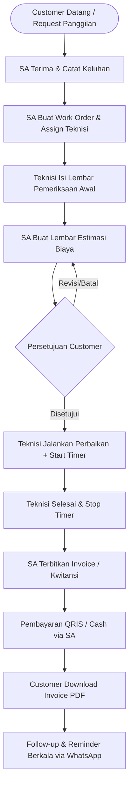
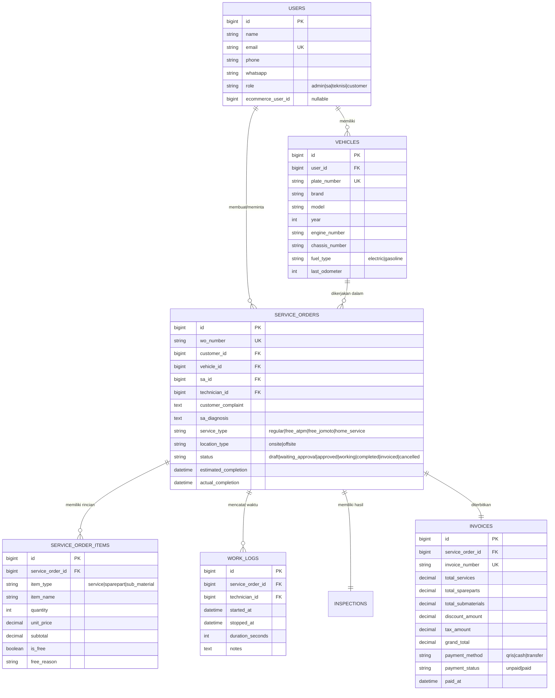

# 🔧 PROGRAM BENGKEL JOMOTO — Project Blueprint & Roadmap

> **Domain Production**: [bengkel.solusisurabaya.com](https://bengkel.solusisurabaya.com)  
> **Stack**: Laravel 11 + Blade / Livewire 3 + MySQL  
> **Target Server**: SSH Alurelab (`emerald.hidden-server.net:31988`, user: `alurelab`)  
> **Repository**: [https://github.com/10969sosho/bengkel-jomoto](https://github.com/10969sosho/bengkel-jomoto)  
> **Status**: 🟢 Setup & Development Ready

---

## 1. Ringkasan Eksekutif & Konsep Bisnis

**Jomoto Center** memiliki ekosistem e-commerce untuk penjualan motor listrik dan sparepart.  
Aplikasi **Program Bengkel** ini dibangun khusus untuk operasional service dan bengkel, dengan prinsip:
1. **Menerima SEMUA Motor**: Tidak terbatas motor listrik Jomoto saja, melainkan melayani seluruh jenis motor (konvensional/bensin & listrik).
2. **Koneksi Stock & Pembelian Sparepart Internal**: Sparepart dapat di-checkout/diambil secara internal dari katalog e-commerce Jomoto via API.
3. **Role-Based Experience**: Memisahkan dashboard & workflow antara Service Adviser (SA), Teknisi, Admin, dan Pelanggan.
4. **Service Fleksibel**: Melayani service di tempat (in-shop) maupun **Service Panggilan (Home Service)**.
5. **Transparansi Biaya & Estimasi**: Customer memberikan persetujuan berdasarkan lembar estimasi sebelum pengerjaan dimulai.

---

## 2. Alur Pelayanan (Service Workflow)

---

## 3. Komponen Biaya & Layanan

### A. Jasa Service (Pricelist Standar)
- **Service Reguler**: Paket servis berkala atau tune-up standar sesuai pricelist bengkel.
- **Service Berkala Gratis (ATPM)**:
  - Kilometer 1.000, 4.000, 7.000
  - Bebas biaya: oli gratis, sparepart gratis, ongkos pengerjaan gratis (klaim garansi resmi).
- **Service Berkala Gratis (Jomoto)**:
  - Kilometer 10.000, 20.000, dst.
  - Bebas ongkos jasa pengerjaan, customer hanya membayar suku cadang.
- **Service Panggilan (Home / On-Site Service)**: Biaya kunjungan tambahan + jasa teknisi.

### B. Penjualan Sparepart (HET)
- Mengikuti Harga Eceran Tertinggi (HET).
- Status stock disinkronkan via API internal dengan e-commerce Jomoto.

### C. Perbaikan Sub-Material (Open Custom Pricing)
Layanan pengerjaan spesifik di luar paket jasa standar dan suku cadang. SA dapat menginput nama tindakan dan biaya secara fleksibel (open item), contoh:
- Gemuk / pelumasan khusus
- Gulung dinamo
- Gerinda / bubut / las
- Repaint / touch-up cat body
- Tindakan kustom lainnya

---

## 4. Dokumen & Formulir Resmi

| Dokumen | Dibuat Oleh | Ditujukan Ke | Fungsi Utama |
|---|---|---|---|
| **Lembar Pemeriksaan Sepeda Motor** | Teknisi | Customer & SA | Hasil inspeksi fisik: rem, ban, baterai/oli, kelistrikan, catatan temuan teknisi |
| **Lembar Estimasi Perbaikan** | Service Adviser (SA) | Customer | Rincian breakdown: Jasa + Sparepart + Sub-Material + Pajak/Diskon sebelum dikerjakan |
| **Surat Perintah Kerja (SPK / WO)** | Service Adviser (SA) | Teknisi | Mandat pengerjaan teknis, target waktu, keluhan awal, dan instruksi penanganan |
| **Invoice / Kwitansi Resmi (PDF)** | SA / Sistem | Customer | Dokumen pembayaran sah dengan rincian biaya, metode bayar (QRIS/Cash), dan barcode |

---

## 5. Fitur & Modul Utama

### 5.1 Role Management & Dashboard Khusus
1. **Service Adviser (SA)**:
   - Registrasi customer & multi-kendaraan.
   - Pembuatan SPK (Work Order) & assign teknisi.
   - Hitung estimasi biaya & checkout sparepart.
   - Generate QRIS payment & cetak Invoice PDF.
   - Quick action: Klik tombol WhatsApp Web untuk reminder service berkala.
2. **Teknisi**:
   - Dashboard antrian tugas mandiri.
   - Checklist pemeriksaan motor interaktif.
   - **Fitur Timer Waktu Pengerjaan** (Start, Pause, Resume, Stop) untuk mengukur durasi pengerjaan aktual per WO.
   - Input laporan penyelesaian tugas.
3. **Customer Portal**:
   - Login terpadu (shared credentials dengan e-commerce).
   - Registrasi multiple motor (plat nomor, rangka, mesin, foto STNK).
   - Pelacakan progress servis real-time.
   - Arsip riwayat servis & unduh Invoice/Kwitansi PDF.
4. **Admin / Supervisor**:
   - Master data jasa, katalog sub-material, dan teknisi.
   - Laporan pendapatan per periode, performa teknisi, dan histori service.

### 5.2 Multi-Kendaraan per Customer
Satu akun pelanggan dapat mendaftarkan banyak unit motor (listrik maupun bensin) dengan detail:
- Merk, Model, Varian, Tahun
- Nomor Polisi (Plat)
- Nomor Rangka & Nomor Mesin
- Catatan odometer (KM) terakhir

### 5.3 Follow-up & Reminder Service (Click-to-WhatsApp)
- Sistem menghitung jadwal servis berikutnya berdasarkan selisih KM atau tanggal terakhir servis.
- SA memiliki tombol instan *"Kirim Reminder WhatsApp"* yang langsung membuka `https://web.whatsapp.com/send?phone=...&text=...` dengan template pesan otomatis ramah dan personal.

### 5.4 API-Ready untuk ERP & E-Commerce
Endpoint REST API standar untuk kebutuhan sinkronisasi eksternal:
- `GET /api/v1/customers` (Sinkronisasi master pelanggan ke ERP)
- `GET /api/v1/service-orders` (Data transaksi untuk modul accounting ERP)
- `GET /api/v1/invoices` (Omzet & status pembayaran)
- `GET /api/v1/spareparts/sync` (Jembatan stok sparepart e-commerce)

---

## 6. Arsitektur Database (High-Level Schema)

---

## 7. Rencana Tahapan Eksekusi (Roadmap)

### Milestone 1: Foundation & Deployment Setup
- [x] Dokumen Blueprint & Skema Alur Service
- [ ] Inisialisasi Repositori GitHub (`10969sosho/bengkel-jomoto`)
- [ ] Konfigurasi Subdomain cPanel `bengkel.solusisurabaya.com` di server Alurelab
- [ ] Inisialisasi Proyek Laravel 11 + Autentikasi & Database Migration
- [ ] Setup script deployment CI/CD atau Git pull otomatis

### Milestone 2: Fitur Inti (Core Flow Demo)
- [ ] Master Data: Pricelist Service, Paket Service Gratis, Sub-Material
- [ ] Modul Kendaraan: Input & list motor per customer
- [ ] Workflow Service Order:
  - Form keluhan & Lembar SPK oleh SA
  - Form Checklist Inspeksi Motor oleh Teknisi
  - Form Lembar Estimasi Biaya & Persetujuan Pelanggan
- [ ] Timer Waktu Pengerjaan Teknisi
- [ ] Billing & Invoice Generator (Format PDF siap cetak + Barcode/QRIS)

### Milestone 3: Fitur Ekstra & Integrasi
- [ ] Tombol Follow-up Reminder via WhatsApp Web
- [ ] Sinkronisasi awal database pelanggan & sparepart e-commerce
- [ ] Endpoint REST API untuk ERP
- [ ] QA Visual Browser & User Acceptance Testing (UAT)

---

## 8. Informasi Teknis & Akses Server

- **SSH Server**: `emerald.hidden-server.net:31988` (Alias: `alurelab`)
- **Web Root Server**: `/home/alurelab/bengkel.solusisurabaya.com/public`
- **Database Engine**: MariaDB / MySQL 8
- **PHP Version**: PHP 8.2 / 8.3
